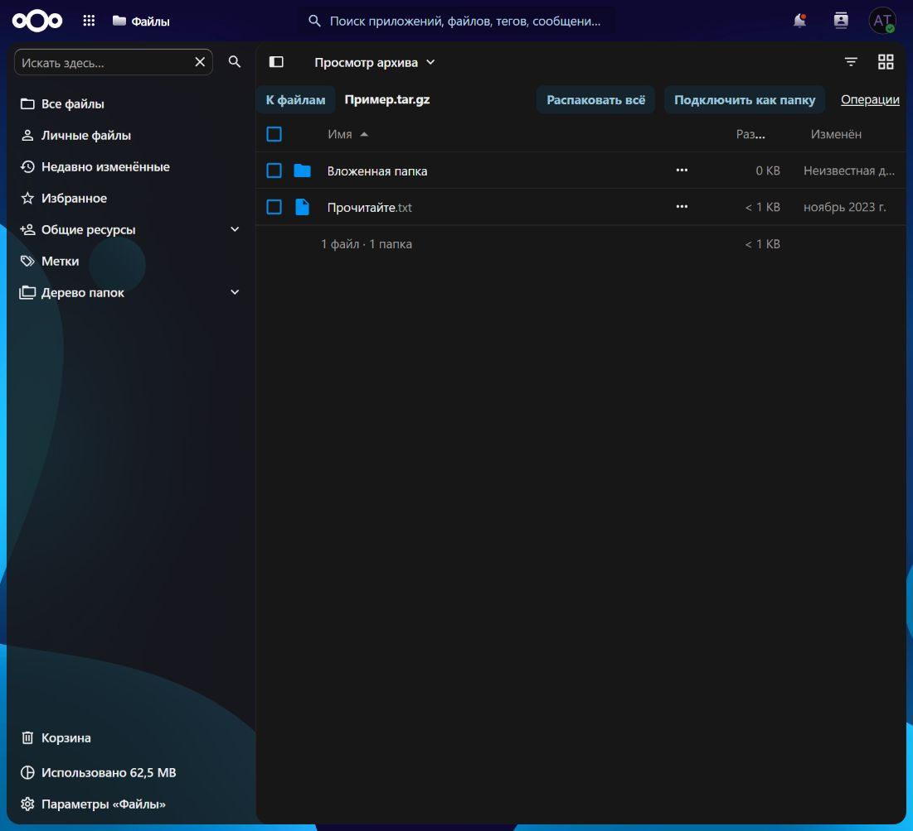

# Archive Tools

[Русская документация](docs/README.ru.md) · [Installation](docs/INSTALL.md) · [Security](SECURITY.md)

Archive Tools is a native Nextcloud application for browsing archives inside Files, extracting selected entries through the background queue, and connecting archives as shared read-only folders accessible through WebDAV.

The `0.5.0-beta.1` development candidate is being prepared for public testing. The stable release gates are tracked in [release preparation](docs/RELEASE.md).

## Features

- ZIP, TAR, TAR.GZ/TGZ, TAR.BZ2/TBZ/TBZ2, TAR.XZ/TXZ, 7z and RAR.
- Native Files navigation, selection, sorting, breadcrumbs and links to nested directories.
- Password-protected archives, individual downloads, full or selected extraction, progress and cancellation.
- Persistent archive connections next to the source file. People with access to both the archive and its parent folder can read the connection with their own accounts.
- Read-only WebDAV access to connected folders, with current source permissions and configurable idle cleanup.
- Administrator-wide opening policy, pinned connections and extraction-history retention.
- Russian and English interfaces.

Opening an archive is temporary and does not create a WebDAV folder. Use **Connect as folder** to create a persistent connection. That connection exposes the archive through Nextcloud without extracting its contents into the user's storage.

## Requirements

The release target is Nextcloud 34–35 and 64-bit PHP 8.5 with `intl`, on a Linux server using local data storage. ZIP requires PHP `zip`; TAR.GZ requires `zlib`.

7z, RAR, TAR.BZ2 and TAR.XZ require a full 7-Zip build, `/usr/bin/prlimit`, and the PHP process functions used by the reader. A build that lists RAR files can still lack RAR decoding support. The server detects available capabilities and exposes the corresponding formats.

In Docker, these dependencies belong in the existing Nextcloud PHP environment. When web and cron run as separate services, both use the image containing the archive tools. The supplied Dockerfile example targets x86-64 and the official `nextcloud:34.0.5-apache` image.

The last complete 0.4.1 baseline covered Nextcloud 34.0.5, PHP 8.5.12, PostgreSQL 17.11 and Redis 7.4.12. The 0.5 matrix includes both declared Nextcloud versions and additional database environments; each candidate needs its own completed validation report.

## Installation and configuration

Follow [installation instructions](docs/INSTALL.md). Release archives contain compiled frontend assets, so Node.js and pnpm are development dependencies only.

Archive Tools uses the existing Nextcloud cron and background queue. A regular `cron.php` run is required for extraction, idle disconnection, history cleanup and recovery of interrupted work.

| Administrator setting | Default |
| --- | --- |
| Open supported archives on click | Enabled |
| Idle timeout | 60 minutes; 0 disables idle cleanup |
| Allow pinning | Enabled |
| Extraction-history retention | 30 days; 0 keeps history indefinitely |

Idle activity is shared among participants. Reading archive contents prolongs the connection. Listing its parent folder or generating a background preview does not keep it connected indefinitely. Pinned connections stay until explicitly disconnected.

`occ archive_tools:diagnose --output=json` reports runtime capabilities and configuration without passwords, user names or data paths.

## Limits and permissions

The index accepts at most 10,000 entries, 4 GiB of expanded contents, depth 32, and 8 MiB of entry names. Each normalized path component is limited to 250 UTF-8 bytes, matching Nextcloud's filename validation. Paths, links, special files and Unicode collisions are validated before use.

Archive connections grant no additional access. Their contents require current read access to the source. Creating a connection requires permission to create content in its parent folder. Archive contents remain read-only.

Source-version checks compare the stored Nextcloud ETag. A change to that tag causes a stale download, extraction or connection request to fail with HTTP 409. On local storage, writes preserving the same modification timestamp can retain an old Nextcloud ETag.

Extraction creates a new destination folder and preserves existing files. Ordinary errors and cancellation remove the operation's own incomplete output. Recovery after a worker crash preserves partial output that may contain user edits and reports the failed operation.

Large and solid archives can require substantial sequential decoding. Extraction has a 300-second processing budget in addition to child-process resource limits. When the budget expires, rollback and lock cleanup finish afterward. Native filesystem calls are checked between operations; a blocking filesystem call is not preempted. Numeric progress is available for extraction; archive opening uses loading states.

## Release scope

Ordinary user and group shares are the target. Team folders, public links, federation, personally authenticated external storage, multipart/SFX archives, editing archives, and directly connecting an archive nested inside another archive are outside the first release scope.

For the documented filesystem extension points and remaining implementation boundaries, see [API compatibility](docs/API_COMPATIBILITY.md).

## Development and licence

See [CONTRIBUTING.md](CONTRIBUTING.md) for development and test commands. Report ordinary defects in [Issues](https://github.com/te4a/nextcloud-archive-tools/issues), and vulnerabilities through [SECURITY.md](SECURITY.md).

Copyright 2026 te4a and Archive Tools contributors. Licensed under **AGPL-3.0-or-later**; see [LICENSE](LICENSE). Test fixture provenance and third-party terms are documented in `tests/fixtures`.
